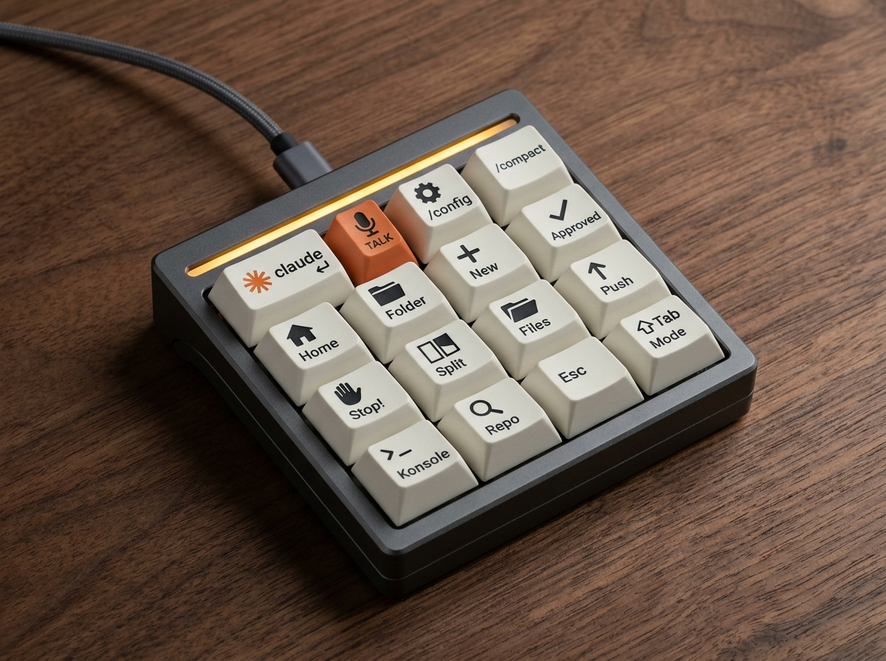

# Key Layout and Key Count

The consolidated list of keys the pad is currently meant to carry, and how many
that adds up to. [`ideated-shortcuts.md`](ideated-shortcuts.md) is the
brainstorm; this file is the shortlist. Last updated 2026-10-24.



*Concept render (Gemini / Nano Banana 2, 2026-10-24) of the 14 keys plus `Esc` and `Shift+Tab`. Key positions in the image are approximate; the table below is authoritative.*

## Submit-style injectors

Most Claude Code keys are **text injection followed by Return**. Typing `/compact`
without pressing Enter does nothing useful, so these keys send the text and then
the Return keystroke as one macro. On Linux the host-side equivalent is
`ydotool type '<text>'` then `ydotool key 28:1 28:0` (Enter), or `wtype '<text>' -k Return`
where the compositor supports it.

Exceptions are called out per key (the mic key sends a key, not text; the
"Approved" / "Stop!" replies are still an open question, see
`ideated-shortcuts.md`).

## Current count: 18 committed keys

| # | Key | Legend / icon | Sends | Submit? | Source |
|---|-----|---------------|-------|---------|--------|
| 1 | **Enter Claude Code** | Claude logo | `claude` + Return (into the focused terminal) | yes | Daniel, 2026-10-24 |
| 2 | **Push-to-talk** | 🎤 microphone | `Space` held (see below) | n/a | Daniel, 2026-10-24 |
| 3 | **Config** | `/config` or ⚙ | `/config` + Return | yes | Daniel, 2026-10-24 |
| 4 | **Compact** | `/compact` | `/compact` + Return | yes | Daniel, 2026-10-24 (promoted from suggestions) |
| 5 | Launch Claude at home level | 🏠 | `konsole -e bash -c "cd ~ && claude"` | — | core #1 |
| 6 | Open this folder in Claude | 📁→Claude | Konsole + `claude` at the focused Dolphin path | — | core #2 |
| 7 | New Claude instance here | ＋ | spawn a new session at cwd | — | core #3 |
| 8 | Approved | ✓ | `approved` (+ Return?) | open | core #4 |
| 9 | Stop! | ✋ | `stop!` (+ Return?) | open | core #5 |
| 10 | Copy Claude (split) | ⧉ | Konsole split, same cwd, `claude` | — | core #6 |
| 11 | Open in file manager | 📂 | `dolphin .` at cwd | — | core #7 |
| 12 | Commit and push | ⬆ | `/commit-and-push` + Return | yes | core #8 |
| 13 | Spawn Konsole here | `>_` | new Konsole at cwd | — | core #9 |
| 14 | Open a repo in Claude | 🔍 | fuzzy repo picker → Konsole + `claude` | — | core #10 |
| 15 | **Model** | `/model` | `/model` + Return | yes | Daniel, 2026-10-24 |
| 16 | **Rewind** | ↶ | `Esc` `Esc` (undo the last turn) | n/a | Daniel, 2026-10-24 |
| 17 | **Go to repos** | 🗂 `~/repos` | `cd <repos_dir>` + Return; path from config (below) | yes | Daniel, 2026-10-24 |

Keys 1 and 5 are deliberately different: key 1 types `claude` into the terminal
you are already in; key 5 opens a new window at `~`.

### The "Go to repos" key (key 17)

The target directory is user-configurable rather than hard-coded:

```yaml
# ~/.config/claude-macropad/config.yaml
repos_dir: ~/repos        # key 17 types: cd ~/repos ⏎
```

The path has to live on the host, not in the pad: QMK/VIA string macros are
baked into firmware and cannot read a host file. So the pad key sends an unused
keycode (e.g. `F14`), a host-side shortcut catches it, and the helper reads
`repos_dir` and injects `cd <repos_dir>` + Return. The Virtual Macropad already
works this way (`type` action in `~/.config/virtual-macropad/config.yaml`). The
config file name and the `F14` routing are proposals, not built yet.

### What 18 means for hardware

- The specs (`specs/esp32-standard.md`, `specs/bom.md`) assumed **10–12 keys**
  (3×3 / 3×4). 18 is two more than a 4×4.
- With the two strongest candidates below (`Esc`, `Shift+Tab`) the wish list is
  **20**. Options:
  - **4×5 (20 keys)**: everything fits exactly. Recommended for the custom
    PCB (Tier 3).
  - **4×4 + rotary encoder push**: put Rewind on the encoder button and drop
    the two candidates.
  - **4×4 + layer**: keep the 16 most-used on layer 1.
- Adafruit MacroPad RP2040 (3×4 + encoder) would need two layers.
- For comparison, OpenAI's Codex Micro (see [`prior-art.md`](prior-art.md)) is
  13 keys plus an encoder.

## The push-to-talk key (key 2)

Claude Code's voice dictation (`/voice`) is bound to `voice:pushToTalk`, default
`Space`, in two modes ([docs](https://code.claude.com/docs/en/voice-dictation)):

- **Hold mode (default):** recording runs while the key is held. Claude Code
  detects the hold by watching for **terminal key-repeat events**, so there is a
  short warmup and a couple of spaces type then get removed. A single tap just
  types a space.
- **Tap mode (`/voice tap`):** tap once to start, tap again to stop and submit
  (auto-submits if the transcript is at least three words).

What that means for the key:

| Pad type | Works in hold mode? | Notes |
|----------|---------------------|-------|
| QMK/VIA or custom firmware, key mapped to plain `KC_SPC` | **Yes** | A held HID key autorepeats at the OS level, which is what hold detection needs. Do not map it as a tap macro. |
| Stream Deck / StreamController | Only if the button holds the key down for the press duration | Default "hotkey" actions are tap-only. Use tap mode otherwise. |
| Virtual Macropad (`linux-desktop/Virtual-Macropad`) | **No** | The pad fires one macro and closes, so it cannot hold a key. Use tap mode. |

Better option for any pad: **rebind `voice:pushToTalk` to a modifier combo or
an unused key** (e.g. `meta+k`, or `F13` from the pad) in
`~/.claude/keybindings.json`. The docs say modifier combos start recording on
the first press with no warmup and work outside the prompt (transcript viewer,
vim normal mode), where `Space` does not. Bare letters are a bad idea in hold
mode. (Whether `F13`–`F24` reach Claude Code through Konsole is not yet tested.)

## Candidate keys (not yet committed)

Ranked. Model, Rewind and Usage were promoted to keys 15, 16 and 18 on 2026-10-24.

| Rank | Key | Sends | Why |
|------|-----|-------|-----|
| 1 | Esc / interrupt | `Esc` | Stops Claude mid-turn; also cancels a dictation. Distinct from the "Stop!" text. |
| 2 | Mode cycle | `Shift+Tab` | Plan / auto-accept / normal. Awkward on a laptop. |
| 3 | Clear | `/clear` + Return | Fresh context without restarting. |
| 4 | Resume | `/resume` + Return | Session picker. |
| 5 | Context | `/context` + Return | See how full the window is before deciding to `/compact`. |
| 6 | Voice toggle | `/voice` + Return | Pairs with key 2; turns dictation on or off. |
| 7 | Accept / deny prompt | `1` / `Esc` (or `Enter`) | Permission dialogs. Overlaps with "Approved". |

A layer key (hold for layer 2) would carry 3 onwards without growing the pad.
