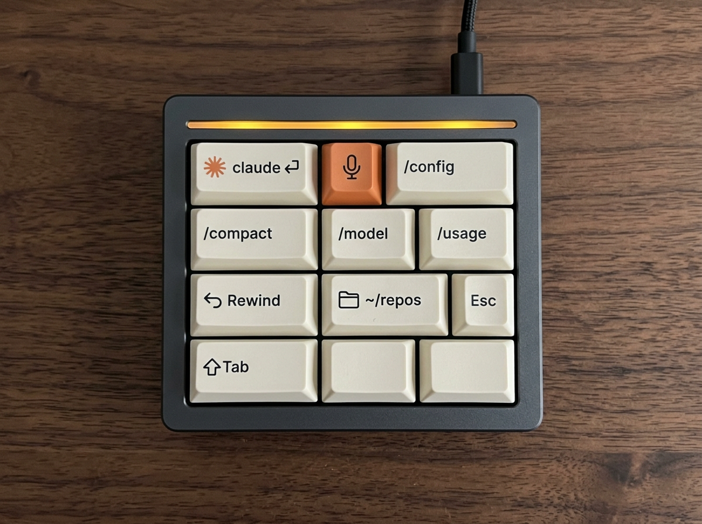

# Key Layout and Key Count

The consolidated list of keys the pad is currently meant to carry, and how many
that adds up to. [`ideated-shortcuts.md`](ideated-shortcuts.md) is the
brainstorm; this file is the shortlist. Last updated 2026-10-24.



*Concept render (Gemini / Nano Banana 2, 2026-10-24) of the 10-key draft on a 3×4 pad. Key positions in the image are approximate; the table below is authoritative.*

## Submit-style injectors

Most Claude Code keys are **text injection followed by Return**. Typing `/compact`
without pressing Enter does nothing useful, so these keys send the text and then
the Return keystroke as one macro. On Linux the host-side equivalent is
`ydotool type '<text>'` then `ydotool key 28:1 28:0` (Enter), or `wtype '<text>' -k Return`
where the compositor supports it. Keys that send a keystroke instead are marked n/a.

## Current draft: 10 keys

Daniel's keys (2026-10-24) plus the two Claude suggested to fill the grid.

| # | Key | Legend / icon | Sends | Submit? | Source |
|---|-----|---------------|-------|---------|--------|
| 1 | **Enter Claude Code** | Claude logo | `claude` + Return (into the focused terminal) | yes | Daniel |
| 2 | **Push-to-talk** | 🎤 microphone | `Space` held (see below) | n/a | Daniel |
| 3 | **Config** | ⚙ `/config` | `/config` + Return | yes | Daniel |
| 4 | **Compact** | `/compact` | `/compact` + Return | yes | Daniel |
| 5 | **Model** | `/model` | `/model` + Return | yes | Daniel |
| 6 | **Usage** | `/usage` | `/usage` + Return (plan limits) | yes | Daniel |
| 7 | **Rewind** | ↶ | `Esc` `Esc` (undo the last turn) | n/a | Daniel |
| 8 | **Go to repos** | 🗂 `~/repos` | `cd <repos_dir>` + Return; path from config (below) | yes | Daniel |
| 9 | Esc / interrupt | `Esc` | `Esc` (stops Claude mid-turn, cancels a dictation) | n/a | Claude |
| 10 | Mode cycle | `⇧Tab` | `Shift+Tab` (plan / auto-accept / normal) | n/a | Claude |

The original ten shortcuts in [`ideated-shortcuts.md`](ideated-shortcuts.md)
(launch at home, Dolphin integration, Approved, Stop!, split, commit and push,
repo picker, etc.) are **not** in this draft; they stay in the brainstorm.

### The "Go to repos" key (key 8)

The target directory is user-configurable rather than hard-coded:

```yaml
# ~/.config/claude-macropad/config.yaml
repos_dir: ~/repos        # key 8 types: cd ~/repos ⏎
```

The path has to live on the host, not in the pad: QMK/VIA string macros are
baked into firmware and cannot read a host file. So the pad key sends an unused
keycode (e.g. `F14`), a host-side shortcut catches it, and the helper reads
`repos_dir` and injects `cd <repos_dir>` + Return. The Virtual Macropad already
works this way (`type` action in `~/.config/virtual-macropad/config.yaml`). The
config file name and the `F14` routing are proposals, not built yet.

### What 10 means for hardware

- Fits a **3×4 (12 keys)** with 2 spare, which matches the original specs
  (`specs/esp32-standard.md`, `specs/bom.md`: 10–12 keys).
- Adafruit MacroPad RP2040 (3×4 + encoder) fits with no layers; the encoder push
  could take Rewind and free a third slot.
- For comparison, OpenAI's Codex Micro (see [`prior-art.md`](prior-art.md)) is
  13 keys plus an encoder.

## The push-to-talk key (key 2)

Claude Code's voice dictation (`/voice`) is bound to `voice:pushToTalk`, default
`Space`, in two modes ([docs](https://code.claude.com/docs/en/voice-dictation)):

- **Hold mode (default):** recording runs while the key is held. Claude Code
  detects the hold by watching for **terminal key-repeat events**, so there is a
  short warmup and a couple of spaces type then get removed. A single tap just
  types a space.
- **Tap mode (`/voice tap`):** tap once to start, tap again to stop and submit
  (auto-submits if the transcript is at least three words).

What that means for the key:

| Pad type | Works in hold mode? | Notes |
|----------|---------------------|-------|
| QMK/VIA or custom firmware, key mapped to plain `KC_SPC` | **Yes** | A held HID key autorepeats at the OS level, which is what hold detection needs. Do not map it as a tap macro. |
| Stream Deck / StreamController | Only if the button holds the key down for the press duration | Default "hotkey" actions are tap-only. Use tap mode otherwise. |
| Virtual Macropad (`linux-desktop/Virtual-Macropad`) | **No** | The pad fires one macro and closes, so it cannot hold a key. Use tap mode. |

Better option for any pad: **rebind `voice:pushToTalk` to a modifier combo or
an unused key** (e.g. `meta+k`, or `F13` from the pad) in
`~/.claude/keybindings.json`. The docs say modifier combos start recording on
the first press with no warmup and work outside the prompt (transcript viewer,
vim normal mode), where `Space` does not. Bare letters are a bad idea in hold
mode. (Whether `F13`–`F24` reach Claude Code through Konsole is not yet tested.)

## Candidates for the 2 spare slots

Ranked.

| Rank | Key | Sends | Why |
|------|-----|-------|-----|
| 1 | Clear | `/clear` + Return | Fresh context without restarting. |
| 2 | Resume | `/resume` + Return | Session picker. |
| 3 | Context | `/context` + Return | See how full the window is before deciding to `/compact`. |
| 4 | Paste image | `Ctrl+V` | Screenshot from the clipboard into the prompt. |
| 5 | Voice toggle | `/voice` + Return | Pairs with key 2; turns dictation on or off. |
| 6 | Accept / deny prompt | `1` / `Esc` (or `Enter`) | Permission dialogs. |
