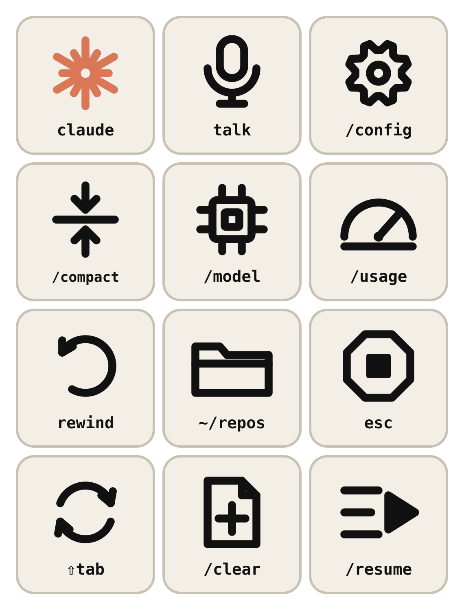
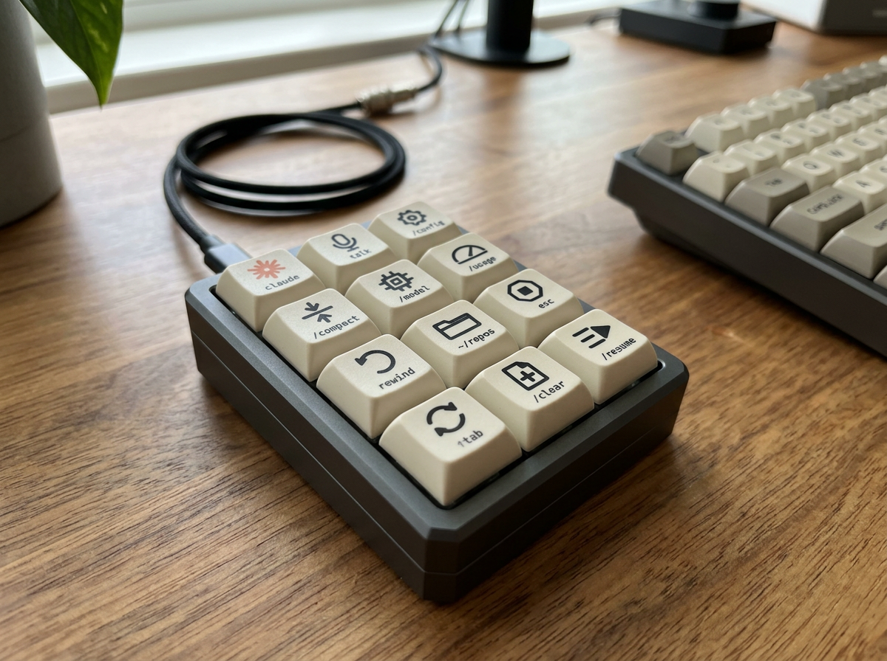

# Keycap Legends

Icon legends for the 12 keys on the 3×4 pad: the 11-key draft in
[`../key-layout.md`](../key-layout.md) plus `/resume`, the rank-1 candidate for
the spare slot (provisional). Drawn 2026-10-24. Printing options and vendor
artwork rules: [`../specs/keycap-printing.md`](../specs/keycap-printing.md).

| # | File | Icon | Label |
|---|------|------|-------|
| 1 | `01-claude` | 12-ray starburst (Claude orange `#D97757` in the colour set) | `claude` |
| 2 | `02-talk` | microphone | `talk` |
| 3 | `03-config` | gear | `/config` |
| 4 | `04-compact` | two arrows closing on a line | `/compact` |
| 5 | `05-model` | chip | `/model` |
| 6 | `06-usage` | gauge | `/usage` |
| 7 | `07-rewind` | counter-clockwise arrow | `rewind` |
| 8 | `08-repos` | folder | `~/repos` |
| 9 | `09-esc` | octagon with stop square | `esc` |
| 10 | `10-mode` | two-arrow cycle | `⇧tab` |
| 11 | `11-clear` | page with plus | `/clear` |
| 12 | `12-resume` | list with play arrow (provisional spare) | `/resume` |

## Files

All generated by [`generate_icons.py`](generate_icons.py) (`python3 keycaps/generate_icons.py`
from the repo root; needs Inkscape 1.x for the outlined, PNG and PDF outputs). Edit
the script, not the outputs.

| Path | What | Use |
|------|------|-----|
| `svg/NN-name.svg` | Colour master, 12×12 mm, live text | Editing |
| `svg/mono/` | Single-ink (`#111111`) version | One-colour printers |
| `outlined/`, `outlined/mono/` | Same with text converted to paths | **Send these to a vendor** (they ask for SVG with fonts outlined) |
| `png/` | 600×600 px raster (≈1270 dpi at 12 mm) | Vendors that want a high-res image |
| `print-sheet-a4.pdf` | Two copies of the set on A4, 14 mm dashed cut squares, 50 mm check line | Relegendable caps (route 1). Print at 100%. |
| `sheet-preview.png` | 3×4 preview in pad order | Docs |

Design rules used: 100-unit box mapped to 12 mm (fits the ~12.7 mm top face of a
DSA/XDA 1u cap), stroke 6.5 units = 0.78 mm, labels in DejaVu Sans Mono Bold at
11.5–13 units (≈1.4–1.6 mm cap height). The 14 mm cut square on the A4 sheet is
a guess: the Adafruit relegendable cap window size is not published, so measure
one and trim.

## Render

fal.ai `fal-ai/nano-banana-2/edit`, 2026-10-24, with `sheet-preview.png` as
the reference image. Two images generated (~$0.16); the other drew a 4×4 pad
with invented keys and was discarded. Key order in the render is approximate.
